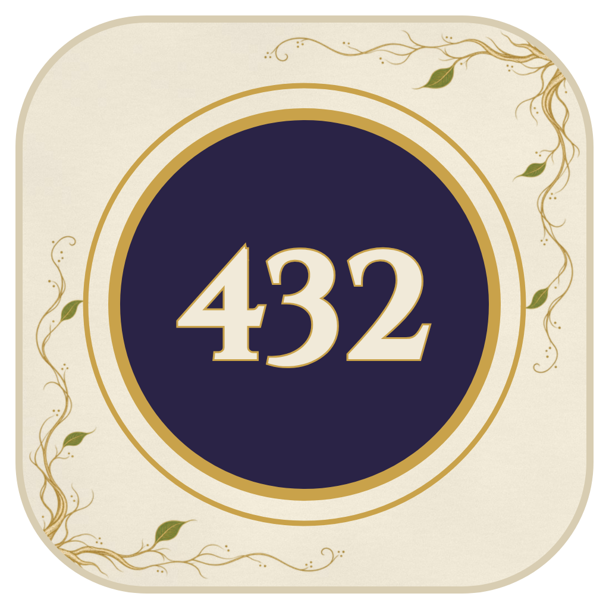

# Accordo 432

**Free Windows app that retunes all system audio from A = 440 Hz to A = 432 Hz.** It works on Spotify, YouTube, games and everything else, with a neutral sound and a one-click switch.

- **Whole system:** works on every app's audio, with no per-app setup.
- **Neutral:** only the pitch changes (−31.77 cents, ratio 432/440). Tempo, EQ and stereo image stay as they are.
- **Live ON / OFF:** switch between 432 Hz and the original 440 Hz while music plays, with a 30 ms crossfade and no jump.
- **GAIN** knob (default 0 dB) and **PEAK GUARD**, a safety limiter that only acts on peaks that would clip. Its red light shows when it works.
- Latency is about 62 ms, which is fine for music, video and most games.
- Lives in the tray near the clock, with an optional start with Windows.

## Download and install

1. Open **[Releases](https://github.com/Lukayda/Accordo432/releases/latest)** and download `Accordo432-Setup-x.y.z.exe`.
2. Run it. The installer asks nothing: it installs, sets up your audio devices and opens the app.
3. **"Windows protected your PC"?** The app is not code-signed, so SmartScreen warns about it. Click **More info → Run anyway**.

Requirements: Windows 10 or 11, 64-bit. Administrator rights are needed to install, because the audio effect is registered in Windows.

## Use

- **ON / OFF** button: 432 Hz or the original 440 Hz.
- **GAIN**: drag up/down or use the mouse wheel. Double-click resets to 0 dB.
- Closing the window keeps the app near the clock. Right-click the tray icon (or the window) for the menu, including **Start with Windows**.
- The 432 effect keeps working even when the app is closed: the app is only the remote control.

## Updates

Once a day the app asks GitHub whether a new version exists. No personal data is sent. If there is one, a notice appears near the clock and "UPDATE" shows in the window footer: click it to download, then run the new installer over the old one.

## Uninstall

Settings → Apps → **Accordo 432** → Uninstall. Audio devices go back to normal. A restart may be needed to remove the last file.

## Good to know

- Accordo 432 is a system **APO** (Audio Processing Object), the official Windows mechanism for system-wide audio effects. It sets `DisableProtectedAudioDG=1` so Windows accepts an effect that is not signed by Microsoft, as other system-wide audio tools do.
- Apps that use exclusive mode or ASIO (some studio software) bypass Windows audio effects, so they are not retuned.
- A big Windows or audio-driver update can unhook it. Reinstalling fixes it.
- Very loud masters (many modern metal or EDM tracks) can keep PEAK GUARD lit even at 440 Hz / 0 dB. It is only catching samples that would clip anyway.
- This project makes no health claims about 432 Hz. It just gives you the choice of tuning.

## Found a problem?

Open an **[Issue](https://github.com/Lukayda/Accordo432/issues/new)** and include your Windows version, your audio device (headphones, speakers, Bluetooth, USB card) and what happens. Fixes come out as new versions in Releases.

## Italiano

**Accordo 432** porta tutto l'audio di Windows da 440 Hz a 432 Hz, gratis e con suono neutro.

- **Installare:** scarica l'installer da **[Releases](https://github.com/Lukayda/Accordo432/releases/latest)** e aprilo: non fa domande. Se compare "PC protetto", clicca **Ulteriori informazioni → Esegui comunque** (l'app non è firmata con un certificato a pagamento).
- **Usare:** il pulsante ON/OFF passa dal vivo tra 432 e 440. La manopola GAIN regola il volume (doppio clic = 0 dB). Clic destro sull'icona vicino all'orologio per il menu, compresa la voce "Start with Windows".
- **Aggiornare:** l'app ti avvisa quando esce una versione nuova.
- **Problemi:** apri una [Issue](https://github.com/Lukayda/Accordo432/issues/new).
- **Disinstallare:** Impostazioni → App → Accordo 432.

## License

Free to use; all rights reserved (see [LICENSE](LICENSE)). The source code is not public. Fonts: Cinzel and Jost, SIL Open Font License 1.1.
